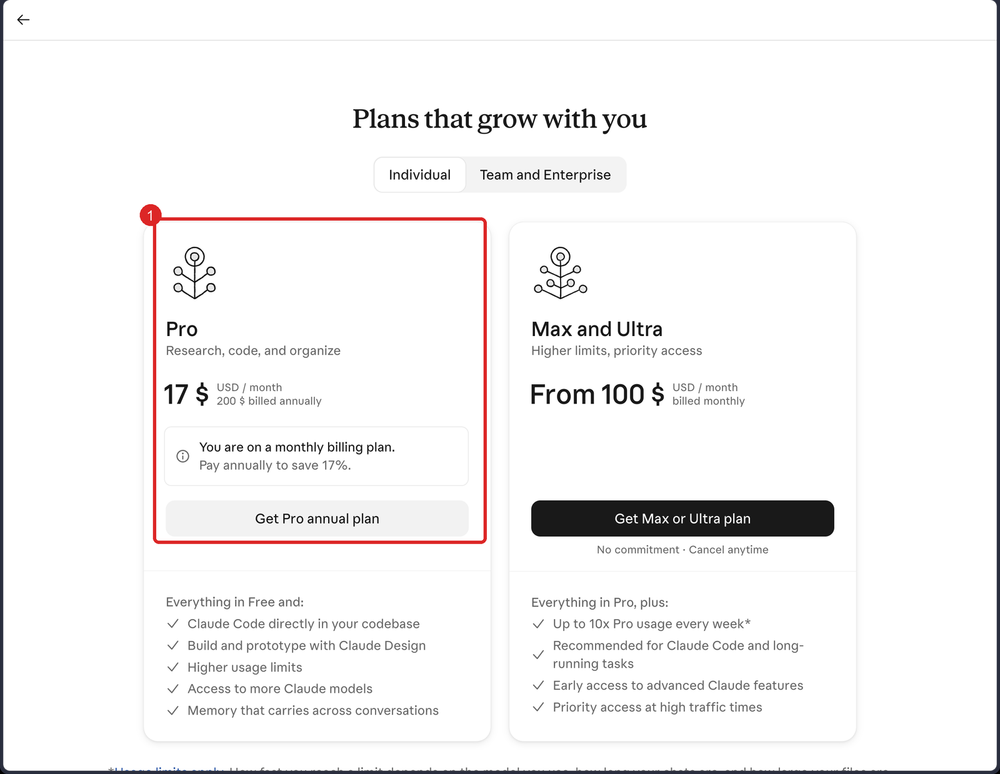
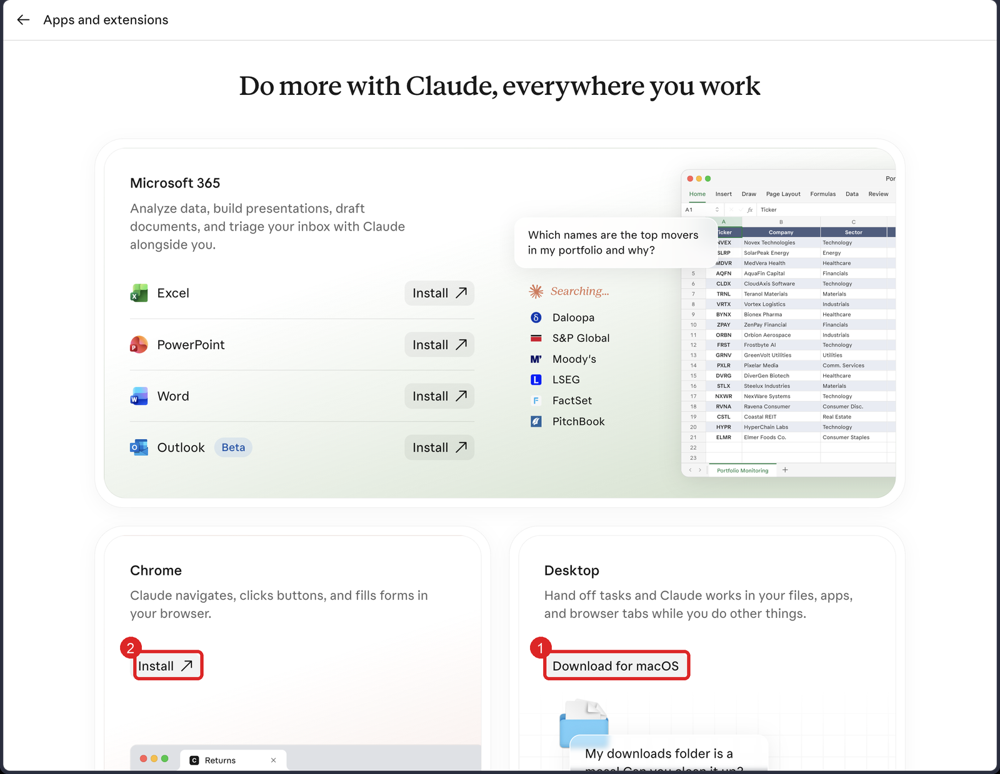
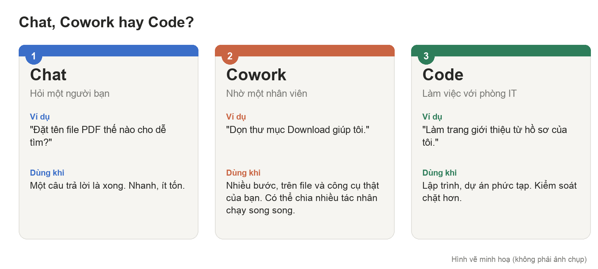
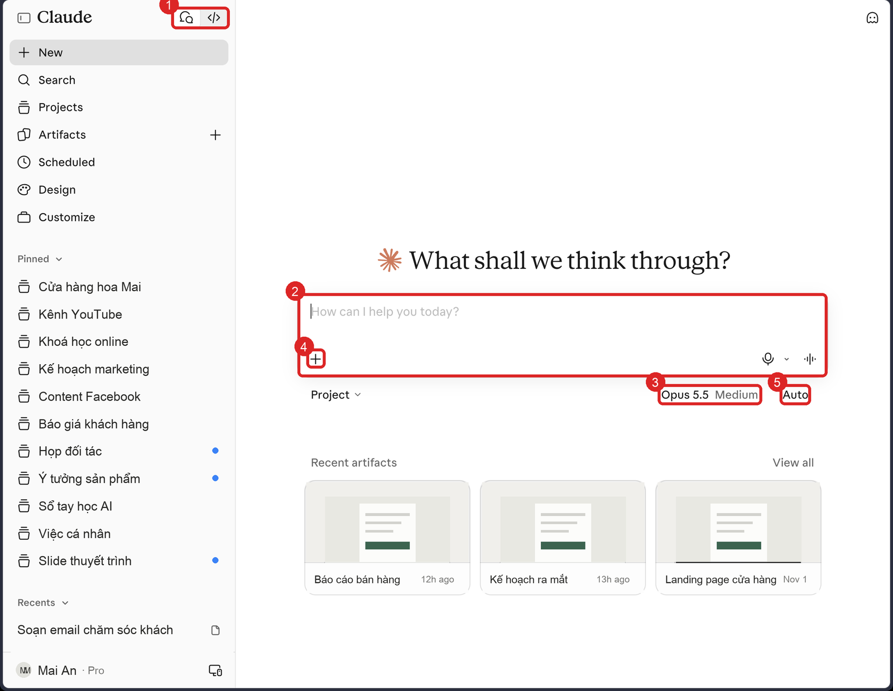
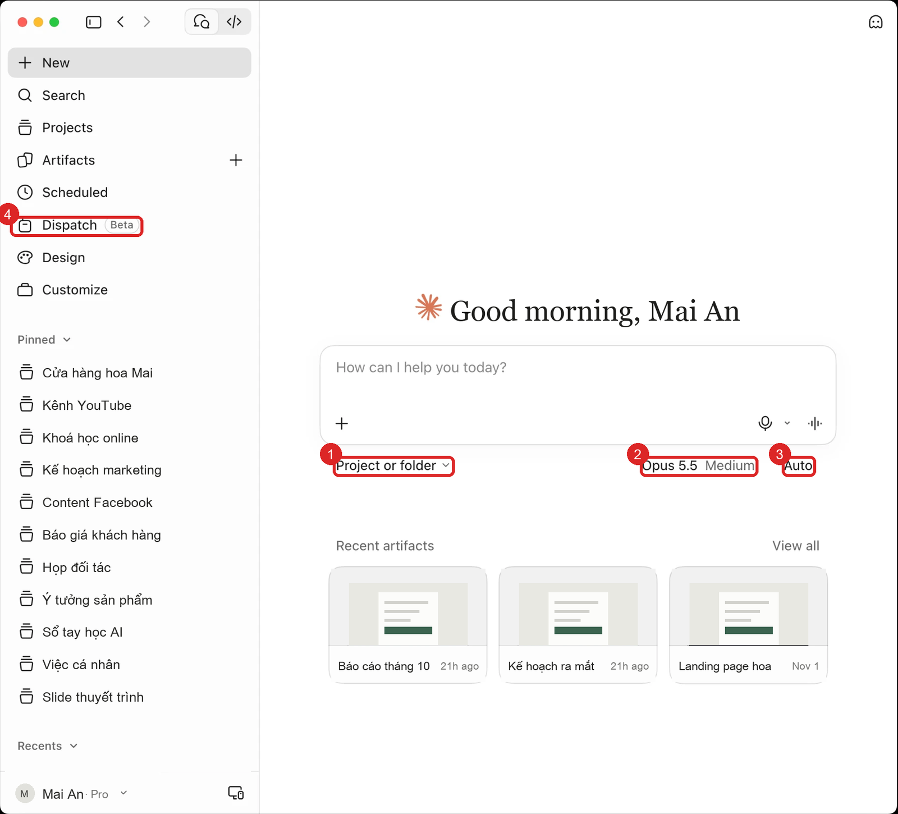
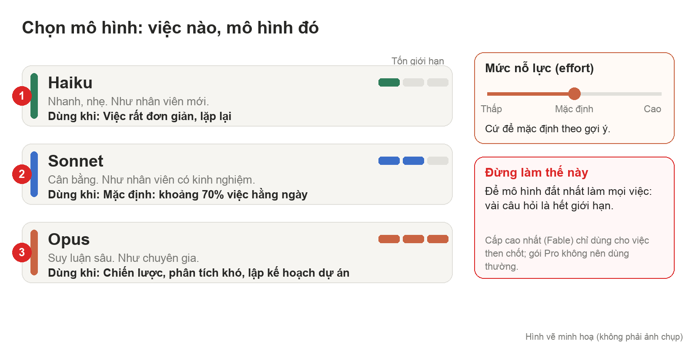
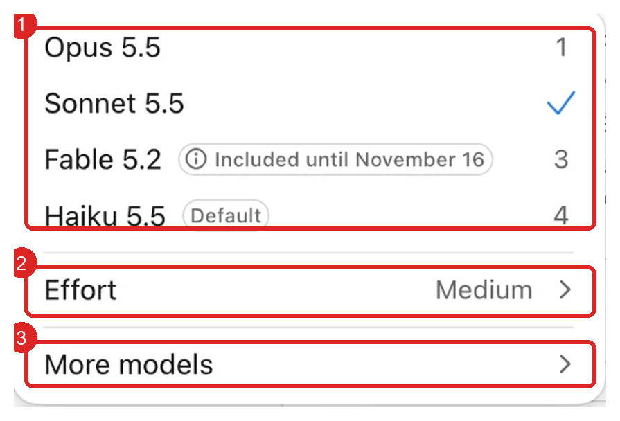

BÀI HỌC TRÀ ĐÁ
Bài 1/3: Tư duy đúng và làm quen Claude
Thời lượng gợi ý: 45 phút. Học đến đâu làm đến đó, đừng đọc một mạch.

Dán vào: cuộc chat có trợ lý Trà Đá. Câu lệnh trong từng bước thì làm ở Claude, rồi quay về dán kết quả.

---------------------------------------------------------------------

BẠN SẼ LÀM ĐƯỢC GÌ SAU BÀI NÀY
- Giải thích được vì sao nên coi Claude là "đối tác tư duy", không phải công cụ tìm kiếm.
- Có Claude cài sẵn trên máy tính và điện thoại, đúng gói.
- Biết chọn đúng mô hình (Haiku, Sonnet, Opus) cho từng loại việc, để không phí giới hạn.
- Biết ba chỗ trên thanh bên (Chat, Cowork, Code) khác nhau thế nào và khi nào dùng chỗ nào.

VÌ SAO BÀI NÀY QUAN TRỌNG
Phần lớn người mới dùng Claude như Google: gõ câu hỏi, đọc câu trả lời, xong. Họ bỏ phí gần hết sức mạnh, rồi nhanh hết giới hạn vì để mô hình đắt nhất làm việc rất dễ. Bài này đặt nền: đổi cách nghĩ, cài đúng, chọn đúng. Ba việc nhỏ nhưng ảnh hưởng đến mọi bài sau.

CẦN CHUẨN BỊ
- Tài khoản claude.ai. Nên có gói Pro (khoảng 20 USD/tháng) trở lên. Gói miễn phí giới hạn nhiều, không thử hết được các bài sau.
- Máy Mac hoặc Windows, và điện thoại.
- Sổ tay Trà Đá đã mở. Mỗi phần lưu dưới tiêu đề "Bài Claude 1 - <tên phần>".

BẢN ĐỒ BÀI
Phần 1: Tư duy (10 phút, không cần máy) → Phần 2: Cài đặt và làm quen (35 phút).

---------------------------------------------------------------------

PHẦN 1. TƯ DUY ĐÚNG TRƯỚC KHI BẤM NÚT

1.1 Hiểu trước
Công cụ nào rồi cũng đổi, tư duy thì giữ lại. Hãy so hai cách dùng:
- Cách cũ: "Claude, viết cho tôi kế hoạch kinh doanh." Claude viết, bạn chép. Bạn không học được gì, và nếu nó sai bạn cũng không biết.
- Cách mới: bạn viết nháp ý chính trước, rồi hỏi "Chỗ nào trong kế hoạch này yếu nhất? Câu hỏi nào khách hàng sẽ hỏi mà tôi chưa trả lời?". Claude phản biện, bạn sửa. Bạn giỏi lên sau mỗi lần.

Năm ý cần nhớ:
1. Claude là đối tác tư duy và trợ lý đa năng. Việc quan trọng thì bạn nghĩ trước, rồi nhờ Claude phản biện, chỉ chỗ hổng, cùng sáng tạo.
2. Việc nặng tay chân (tóm tắt, tổng hợp, phân tích nhiều dữ liệu) giao cho Claude. Việc cần nghĩ sâu bạn làm trước.
3. Claude vẫn có thể nói sai một cách rất tự tin (gọi là "ảo giác"). Mô hình mới thì ít hơn, không hết. Số liệu, ngày tháng, trích dẫn: bạn tự kiểm.
4. Cái gì cũng hỏi rồi tin hết sẽ làm bạn lười nghĩ. Hình dung như thuê huấn luyện viên: người tập vẫn là bạn.
5. Câu chốt: AI khuếch đại tư duy, không thay thế tư duy.

1.2 Làm
Mở Sổ tay, gõ tiêu đề "Bài Claude 1 - Tư duy". Viết lại 5 ý trên bằng lời của bạn (mỗi ý một câu). Sau đó viết thêm:
- 1 việc thật của bạn nên giao cho Claude làm phần nặng tay chân.
- 1 việc thật bạn sẽ tự nghĩ trước rồi mới nhờ Claude phản biện.

1.3 Tự kiểm
Đúng khi: 5 ý viết bằng lời của bạn (không chép nguyên), và 2 việc đều là việc có thật trong công việc của bạn.
Chưa được thì: nếu bạn chưa nghĩ ra việc nào, hãy nhớ lại việc nào tuần trước làm bạn mất nhiều giờ nhất.

1.4 Dừng lại, tự hỏi
- Nếu Claude đưa một con số mà bạn không chắc, bạn làm gì?
- Việc nào của bạn mà nếu giao hết cho AI, bạn sẽ mất đi một kỹ năng quan trọng?

---------------------------------------------------------------------

PHẦN 2. CÀI ĐẶT VÀ LÀM QUEN GIAO DIỆN

Bước 2.1 Chọn gói
Hiểu trước: giới hạn dùng của Claude tính theo gói. Dùng nhiều mà gói nhỏ thì hết giới hạn giữa chừng rất khó chịu.
- Gói Pro: đủ cho người làm văn phòng thường ngày.
- Gói Max (100 hoặc 200 USD): cho việc rất nặng, nhất là lập trình.
- Mẹo: mua theo tháng. Tháng nào nhẹ việc thì Pro; tháng nào dồn nhiều việc thì lên Max, xong thì quay về Pro. Mua theo năm rẻ hơn nhưng mất linh hoạt.
Làm: nếu chưa có, nâng lên Pro.
Hình minh hoạ (dùng tên giả, giao diện sáng):

Nhìn hình: ① khung gói Pro (khoảng 17–20 USD/tháng, mua theo năm rẻ hơn). Gói Max and Ultra nằm ngay bên phải. Dòng "You are on a monthly billing plan" cho biết bạn đang trả theo tháng.

Đúng khi: ảnh chụp trang gói hiện Pro hoặc Max (che email).

Bước 2.2 Cài app trên máy và điện thoại
Hiểu trước: bản web chat thì được, nhưng các tính năng làm việc trên file thật của bạn (Cowork, Code) chạy tốt nhất trên app máy tính.
Làm:
1. Vào claude.ai/downloads, tải bản đúng máy (Mac hoặc Windows), cài và đăng nhập.
2. Làm theo gợi ý cài tiện ích Chrome để Claude điều khiển trình duyệt khi cần.
3. Có Microsoft 365 thì nối thêm Excel, PowerPoint, Word.
4. Cài app trên điện thoại (iOS hoặc Android), đăng nhập cùng tài khoản.
Hình minh hoạ (dùng tên giả, giao diện sáng):

Nhìn hình: ① nút tải app máy tính (bản Mac; Windows sẽ hiện nút tương ứng). ② nút Install tiện ích cho Chrome. Phần Microsoft 365 phía trên là các nút nối với Excel, PowerPoint, Word.

Đúng khi: mở được app trên máy và điện thoại, cùng một tài khoản, thấy cùng lịch sử chat.

Bước 2.3 Hiểu ba chỗ trên thanh bên
Hiểu trước, bằng ví dụ: bạn có một thư mục Download rất lộn xộn.
- Chat là hỏi một người bạn: "File PDF nên đặt tên thế nào cho dễ tìm?". Hỏi đáp nhanh, xử lý việc ngắn.
- Cowork là nhờ một nhân viên: "Dọn thư mục này giúp tôi". Claude làm nhiều bước trên thư mục và công cụ của bạn, có thể tự chia nhiều tác nhân nhỏ chạy song song.
- Code là làm việc với phòng IT: dành cho lập trình và dự án phức tạp, kiểm soát chặt hơn. Bài 3 sẽ dùng.
Hình vẽ minh hoạ:

Nhìn hình: mỗi cột là một cách làm việc với Claude. Số ①②③ là thứ tự từ nhẹ đến nặng.

Mẹo chọn: một câu trả lời là xong thì Chat; cần nhiều bước trên file thật thì Cowork.
Hình minh hoạ (dùng tên giả, giao diện sáng):

Nhìn hình: ① công tắc chuyển giữa Chat và Code (Cowork có trên app máy tính, bản web có thể chưa hiện). ② ô nhập yêu cầu. ③ chỗ chọn mô hình và mức nỗ lực (Opus 5.5, Medium). ④ dấu cộng để thêm file, bật Research. ⑤ chế độ chạy (Auto: Claude tự chạy; Bài 3 nói cách kiểm soát). Thanh bên trái là nơi vào Projects, Artifacts, Scheduled, Customize (các bài sau dùng).

Làm: 
Ảnh chụp thật từ app Claude (dùng tên giả):

Nhìn hình: ① chỗ chọn Project hoặc thư mục để Claude làm việc trong đó. ② mô hình và mức nỗ lực. ③ chế độ quyền (Auto). ④ Dispatch (Beta): giao việc từ điện thoại cho Claude đang mở trên máy tính. Thanh bên trái là Projects, Artifacts, Scheduled, Design, Customize.

Làm: mở app, bấm lần lượt Chat, Cowork, Code, nhìn giao diện từng chỗ (chưa cần làm gì).
Đúng khi: bạn nói được bằng lời của mình khác biệt giữa Chat và Cowork, kèm 1 ví dụ việc của bạn cho mỗi bên.

Bước 2.4 Chọn mô hình và mức nỗ lực (effort)
Hiểu trước: giống như chọn người làm việc. Việc gọt trái cây mà dùng dao chặt xương thì phí. Việc khó mà giao cho người mới thì hỏng. Nhiều người để mặc định mô hình đắt nhất rồi hết giới hạn rất nhanh.

| Mô hình | Hình dung | Dùng khi |
| Haiku | nhân viên ít kinh nghiệm, nhanh | việc rất đơn giản, lặp lại |
| Sonnet | nhân viên có kinh nghiệm | mặc định cho khoảng 70% việc hằng ngày |
| Opus | chuyên gia | lên chiến lược, phân tích sâu, lập kế hoạch cho dự án khó |
| Cấp cao nhất (Fable) | chuyên gia đầu ngành | việc then chốt; đốt giới hạn rất nhanh, gói Pro không nên dùng thường |

Tên và độ mạnh từng mô hình có thể thay đổi theo bản mới; nguyên tắc thì không đổi: việc dễ dùng mô hình thấp, việc khó mới lên cao.
Effort là mức Claude "bỏ công" suy nghĩ. Thấp thì nhanh và tốn ít nhưng nông hơn. Cứ để mặc định theo gợi ý của mô hình.

Hình vẽ minh hoạ:

Nhìn hình: ba thanh bên phải mỗi mô hình cho thấy mức tốn giới hạn: càng lên cao càng tốn. Khung cam là mức nỗ lực, khung đỏ là điều cần tránh.

Ảnh chụp thật từ app Claude (dùng tên giả):

Nhìn hình: ① danh sách mô hình (dấu tích là mô hình đang chọn; Haiku 5.5 đang là mặc định của app). Dòng Fable 5.2 ghi "Included until November 16": tức đang được tính vào gói đến ngày đó, đọc kỹ dòng này trước khi dùng. ② Effort: mức nỗ lực, để mặc định. ③ More models: mở thêm các mô hình khác.

Làm (so sánh để thấy khác biệt):
1. Chọn Sonnet, hỏi: "Viết giúp tôi tin nhắn cảm ơn khách vừa mua hàng, 3 dòng."
2. Chọn Opus, hỏi: "Tôi định tăng giá sản phẩm 15%. Hãy phân tích rủi ro và đề xuất cách thử nghiệm an toàn." (thay bằng tình huống thật của bạn)
3. Nhìn độ sâu của hai câu trả lời, và nhớ lượng giới hạn đã dùng.
Đúng khi: bạn viết được 1 câu quy tắc của riêng mình, ví dụ "viết tin nhắn = Sonnet; kế hoạch kinh doanh = Opus", vào Sổ tay.
Chưa được thì: nếu không thấy khác biệt, thử một câu khó hơn cho Opus (có nhiều bên liên quan, cần cân nhắc).

Bước 2.5 Dấu cộng cạnh ô nhắn
Hiểu trước: dấu cộng là hộp công cụ. Nội dung hộp khác nhau giữa Chat và Cowork.
- Thêm file, ảnh: để Claude có ngữ cảnh.
- Thêm cuộc chat vào một Project (Bài 2 học sâu).
- Research (nghiên cứu sâu): Claude tìm nhiều nguồn trên mạng rồi viết báo cáo đầy đủ. Tốn nhiều giới hạn, dùng khi thật cần tìm hiểu một chủ đề. Không bật thì câu trả lời thường ngắn và nông.
- Web search và Memory: nên bật để Claude tự tìm trên mạng khi cần và nhớ bạn qua các lần chat.
- Trong Cowork: chọn Auto (Claude tự chạy) hoặc duyệt tay từng bước (an toàn hơn, chậm hơn); chọn thư mục làm việc.
Làm: bật Research, hỏi một chủ đề bạn đang cần tìm hiểu (ví dụ "xu hướng ứng dụng AI trong ngành của tôi năm nay").
Đúng khi: bạn thấy Claude đi tìm nhiều nguồn trước, rồi mới ra báo cáo có dẫn nguồn.

---------------------------------------------------------------------

TỔNG KẾT: 3 ĐIỀU NHỚ
1. Bạn nghĩ trước, Claude phản biện và làm phần nặng.
2. Việc dễ dùng mô hình thấp, việc khó dùng mô hình cao; không để mặc định.
3. Cài app trên máy và điện thoại; chọn Chat hay Cowork theo độ nhiều bước của việc.

ĐẠT KHI
1. Có 5 ý tư duy trong Sổ tay, kèm 1 việc giao Claude và 1 việc tự nghĩ trước.
2. Đã chọn gói, cài app, có ảnh chứng minh (che email).
3. Có 1 câu quy tắc chọn mô hình của riêng bạn, đã thử Sonnet và Opus trên 2 câu khác độ khó.
4. Đã bật thử Research và thấy Claude đi tìm nguồn.

TIÊU CHÍ CHẤM
- Có bằng chứng thật (chữ Claude trả, ảnh chụp), không chỉ nói "xong".
- Không lộ mật khẩu, khóa API, số thẻ.

LỖI HAY GẶP
- Hết giới hạn sau vài câu: đang để mô hình cao mặc định. Xuống Sonnet.
- Không thấy mục Cowork hay Code: chưa cài app trên máy hoặc chưa cập nhật bản mới.

LƯU KẾT QUẢ
Sổ tay Trà Đá, tiêu đề "Bài Claude 1": 5 ý tư duy, quy tắc chọn mô hình, ảnh chụp gói và app.

DÙNG TIẾP
Bài 2 dùng tài khoản, app và quy tắc chọn mô hình ở đây.
