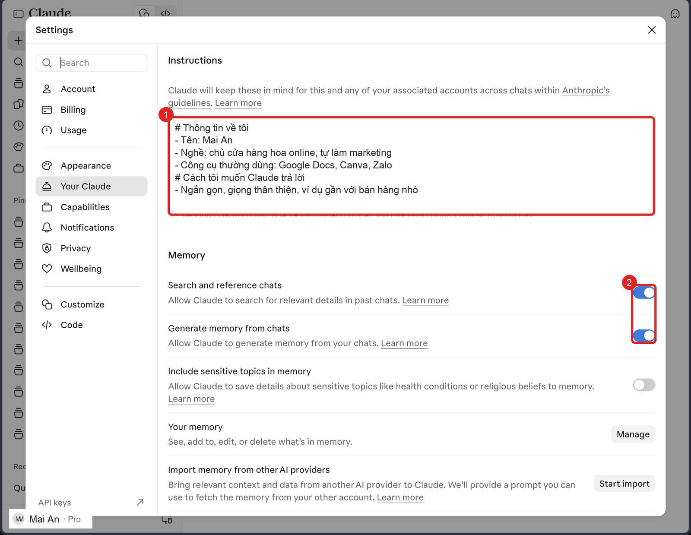
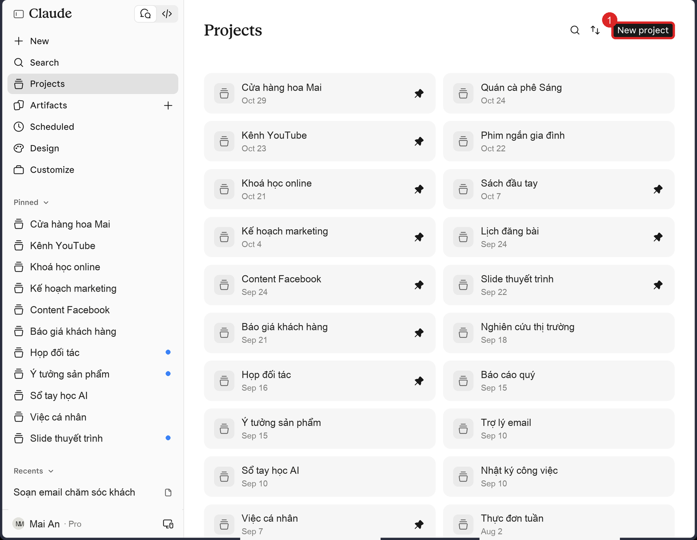
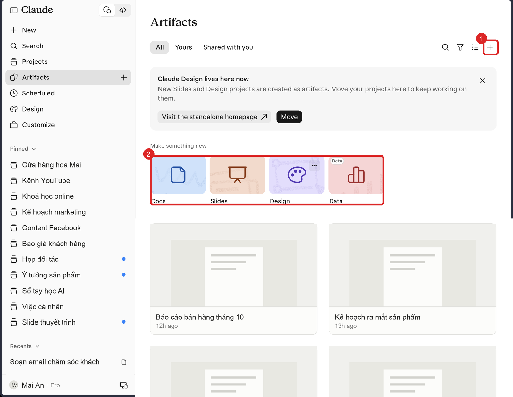
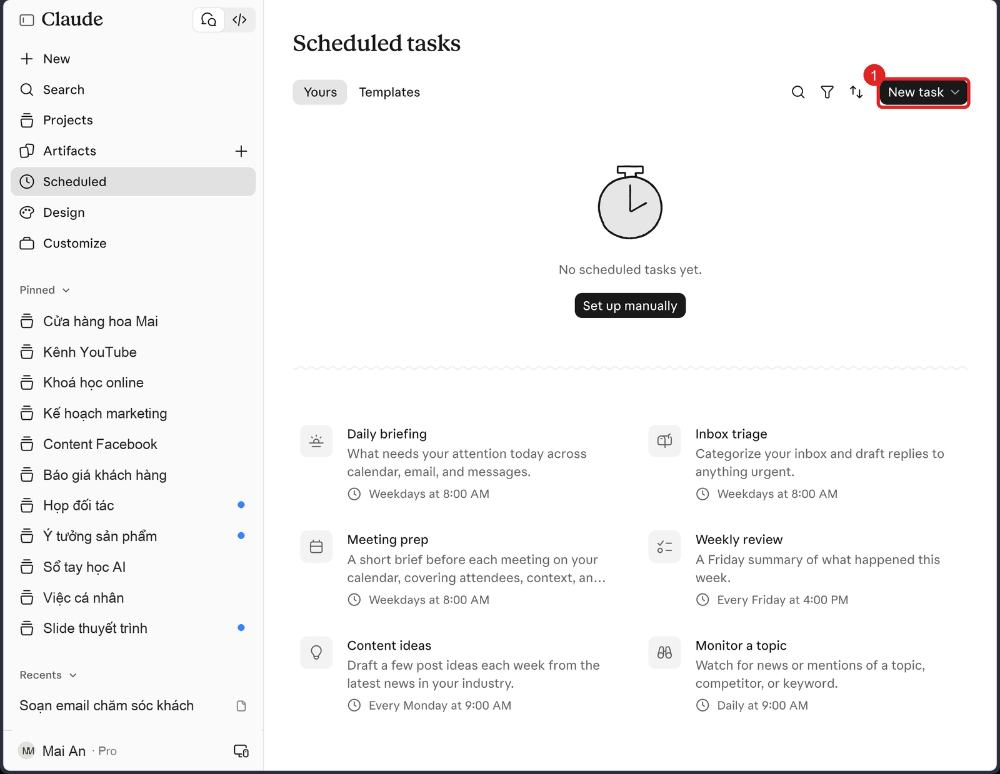
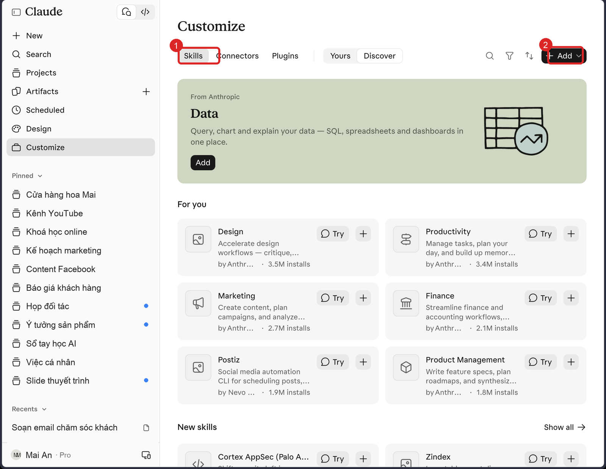
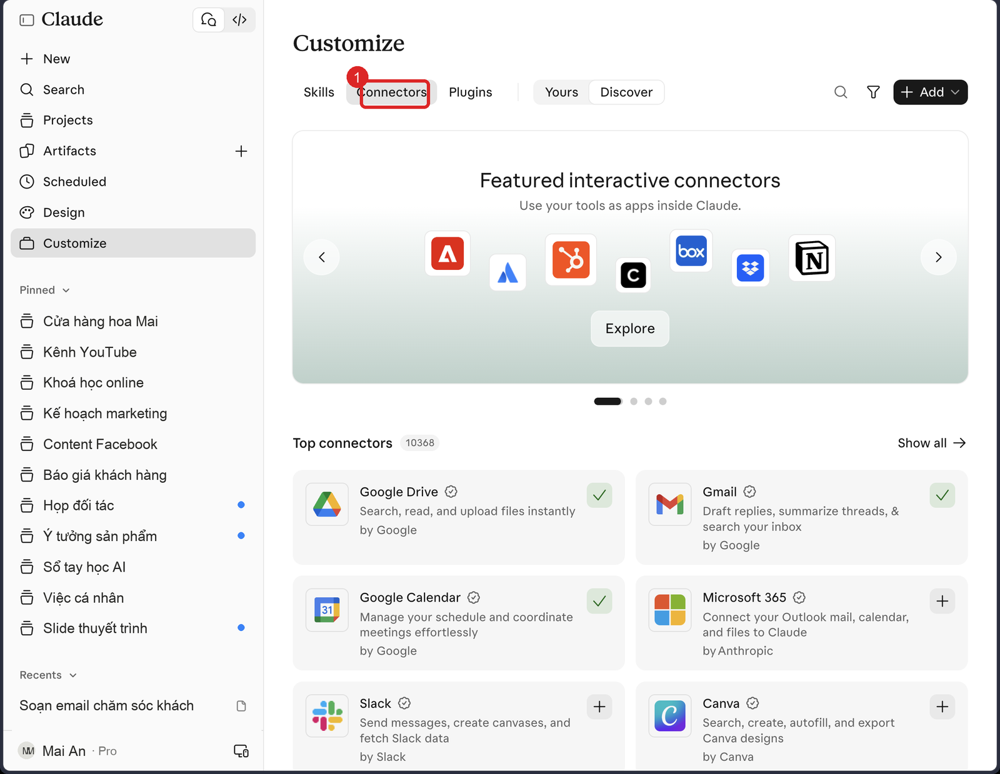

BÀI HỌC TRÀ ĐÁ
Bài 2/3: Biến Claude thành trợ lý của riêng bạn
Thời lượng gợi ý: 90 phút, chia 2 buổi (Phần 3 trước, Phần 4 sau).

Dán vào: cuộc chat có trợ lý Trà Đá. Câu lệnh trong từng bước thì làm ở Claude, rồi quay về dán kết quả.

---------------------------------------------------------------------

BẠN SẼ LÀM ĐƯỢC GÌ SAU BÀI NÀY
- Claude hiểu bạn ngay từ câu đầu tiên, không phải giới thiệu lại mỗi lần chat.
- Một Project cho một mảng việc thật, chat trong đó tự biết bối cảnh.
- Một việc tự chạy định kỳ (ví dụ báo cáo mỗi sáng thứ Hai).
- Một skill riêng đóng gói quy trình bạn hay làm, và một connector nối với công cụ bạn đang dùng.

VÌ SAO BÀI NÀY QUAN TRỌNG
Claude chưa biết gì về bạn: nghề, khách hàng, giọng văn, quy trình. Không nói thì nó trả lời chung chung. Đây là bài biến "một chatbot cho ai cũng được" thành "trợ lý của riêng bạn". Làm một lần, hưởng lâu dài.

CẦN CHUẨN BỊ
- Đã xong Bài 1.
- Một đoạn giới thiệu bản thân (CV hoặc vài đoạn bạn tự viết).
- Vài tài liệu nền của một mảng việc thật (bảng giá, hồ sơ năng lực, quy trình...).
- Sổ tay Trà Đá, tiêu đề "Bài Claude 2 - <tên phần>".

BẢN ĐỒ BÀI
Phần 3: Instructions → Project → Artifact → Schedule. Phần 4: Skill → Connector → Plugin → Design.
Nguyên tắc: học bước nào, làm xong bước đó rồi mới đi tiếp.

---------------------------------------------------------------------

PHẦN 3. DẠY CLAUDE HIỂU BẠN

Bước 3.1 Instructions for Claude (làm đầu tiên)
Hiểu trước: giống nhân viên mới ngày đầu đi làm. Nếu bạn đưa một bản "tôi là ai, tôi làm gì, tôi muốn được hỗ trợ thế nào", họ làm đúng ngay. Không đưa thì họ đoán.
Xem mẫu: phần Instructions của một giảng viên có thể gồm: nghề và kinh nghiệm, các dịch vụ đang cung cấp, giọng văn mong muốn (khiêm tốn, giản dị), điều không muốn (khoa trương, sáo rỗng). Có thể dài vài trang.
Làm:
1. Đừng tự viết từ số 0. Mở chat mới, chọn Sonnet hoặc Opus, dán:
```
Tôi muốn viết phần hướng dẫn chi tiết cho Claude để bạn hiểu tôi và hỗ trợ tốt hơn trong công việc. Tôi sẽ đưa thông tin về bản thân. Hãy phân tích, sau đó hỏi tôi từng nhóm câu hỏi cho đến khi bạn đủ thông tin, rồi viết bản hướng dẫn hoàn chỉnh để tôi dán vào phần Instructions.
[dán CV hoặc đoạn giới thiệu của bạn]
```
2. Trả lời các câu Claude hỏi. Có thể nói bằng giọng (nhập giọng nói trên máy) cho nhanh.
3. Đọc kỹ bản Claude viết, sửa chỗ sai.
4. Bấm tên bạn (góc trái dưới) → Settings. Ở mục Account điền tên gọi và nghề nghiệp. Ở mục Your Claude, dán bản hướng dẫn vào ô Instructions, rồi lưu.
5. Lưu bản này vào Sổ tay.
Hình minh hoạ (dùng tên giả, giao diện sáng):

Nhìn hình: ① ô Instructions: đây là chỗ bạn dán bản hướng dẫn Claude viết. ② các công tắc Memory ở bên dưới (Claude nhớ bạn qua các lần chat; Bài 3 nói thêm về quyền riêng tư). Nội dung trong ô chỉ là ví dụ với tên giả.

Tự kiểm: mở chat mới, hỏi "Bạn biết gì về tôi?".
Đúng khi: Claude nói đúng nghề, việc, giọng văn của bạn, không bịa chi tiết lạ.
Chưa được thì: nếu trả lời chung chung, bổ sung thêm thông tin cụ thể (khách hàng, sản phẩm, ví dụ bài bạn từng viết) rồi hỏi lại.
Lưu ý riêng tư: không dán mật khẩu, số thẻ, giấy tờ tùy thân vào Instructions.

Bước 3.2 Project
Hiểu trước: Project giống một phòng ban. Phòng marketing có tài liệu marketing và quy tắc của phòng marketing. Bước vào phòng đó làm việc, bạn không phải mang tài liệu theo mỗi lần.
Xem mẫu: một người làm kênh YouTube tạo project "Kênh YouTube": gắn thư mục dữ liệu kênh, viết quy tắc "bạn là chiến lược gia kênh của tôi...". Mỗi lần chat trong project, Claude đã biết kênh đó.
Làm:
1. Projects → New project. Đặt tên theo việc thật (ví dụ "Việc - Bán hàng").
2. Mô tả mục tiêu của project.
3. Thêm file nền (context) để Claude luôn đọc trước. Có thể trỏ tới một thư mục trên máy.
4. Phần instruction của project: nhờ Claude viết giúp. Trong chat của project, dán:
```
Tôi đang tạo một project cho [mảng việc]. Mục tiêu: [mục tiêu]. Hãy hỏi tôi những gì bạn cần biết, rồi viết phần instruction để bạn làm trợ lý đúng cho mảng này: vai trò, cách trả lời, điều phải tránh.
```
5. Duyệt bản Claude viết, dán vào phần instruction của project.
Hình minh hoạ (dùng tên giả, giao diện sáng):

Nhìn hình: ① nút New project. Mỗi thẻ là một dự án; ghim (hình ghim) để dự án hiện trên thanh bên.

Tự kiểm: mở chat mới trong project, hỏi một câu về mảng việc đó, không dán thêm gì.
Đúng khi: Claude trả lời dựa đúng file và quy tắc đã đưa.
Chưa được thì: kiểm tra bạn có đang chat bên ngoài project không; kiểm tra file đã được thêm vào đúng project chưa.
Gợi ý mở rộng: làm project "người cố vấn" từ vài tài liệu cốt lõi của một chuyên gia bạn tin cậy (chỉ dùng tài liệu bạn được phép dùng).

Bước 3.3 Artifact
Hiểu trước: Artifact là sản phẩm Claude tạo ngay trong chat (trang web, báo cáo, biểu đồ, bảng theo dõi), lưu lại để xem, sửa, chia sẻ bằng đường link. Khác với một đoạn chữ: bạn dùng được ngay.
Làm: dán một bài dài hoặc ghi chú của bạn, rồi:
```
Tạo cho tôi một trang web trực quan từ nội dung này: có mục lục, tiêu đề rõ, dễ đọc trên điện thoại.
```
Hình minh hoạ (dùng tên giả, giao diện sáng):

Nhìn hình: ① dấu cộng để tạo artifact mới. ② các loại có thể tạo: Docs, Slides, Design, Data. Mỗi thẻ bên dưới là một artifact đã tạo.

Đúng khi: thấy trang hiện bên cạnh chat và sửa được bằng lời ("đổi màu chủ đạo sang xanh").
Lưu ý: bấm chia sẻ là bất kỳ ai có link đều xem được. Ghi lại bạn đã chia sẻ gì (Bài 3 dạy cách rà lại).

Bước 3.4 Schedule task
Hiểu trước: việc nào bạn muốn lặp lại theo giờ, ngày, tuần thì giao cho Claude một lần, rồi nó tự chạy.
Xem mẫu: "Mỗi sáng tóm tắt email và lịch ba ngày tới" hoặc "Mỗi sáng thứ Hai 9 giờ, tổng hợp xu hướng [chủ đề], gạch đầu dòng, kèm link nguồn uy tín".
Làm:
1. Vào Schedule → New task → chọn "Create with Claude" (không chọn thiết lập thủ công cho khó).
2. Trả lời các câu Claude hỏi: chủ đề, tần suất, giờ chạy, cách nhận kết quả, cách trình bày.
3. Chọn mô hình Sonnet cho vừa giới hạn. Việc cần đọc file trên máy thì máy phải mở khi đến giờ chạy.
4. Bấm tạo, rồi chạy thử một lần.
Hình minh hoạ (dùng tên giả, giao diện sáng):

Nhìn hình: ① nút New task. Danh sách mẫu bên dưới (Daily briefing, Weekly review...) là gợi ý để bạn bấm dùng thử.

Đúng khi: task hiện trong danh sách Schedule, có giờ chạy, và chạy thử ra kết quả đúng ý.
Chưa được thì: kết quả lan man thì sửa lại mô tả, thêm "dưới 10 gạch đầu dòng, mỗi ý kèm nguồn".

Bước 3.5 (tùy chọn) Dispatch
Dùng điện thoại giao việc cho Claude đang mở trên máy tính ở nhà. Chỉ cần khi gấp; có thể bỏ qua.

Dừng lại, tự hỏi:
- Instructions khác Project ở chỗ nào? (Instructions: áp dụng cho mọi chat. Project: chỉ cho một mảng việc.)
- Việc nào của bạn nên chuyển thành Schedule task?

---------------------------------------------------------------------

PHẦN 4. TRANG BỊ THÊM CHO CLAUDE

Hiểu trước, một hình dung chung: Claude như nhân viên mới. Skill là kỹ năng và quy trình. Connector là quyền truy cập công cụ làm việc. Plugin là cả bộ gồm nhiều skill và connector.

Bước 4.1 Skill riêng
Hiểu trước: nếu bạn không nói thì Claude không biết quy trình 5 bước của bạn, hay điều bạn không bao giờ muốn. Skill ghi lại một lần để Claude dùng mỗi khi gặp việc đó.
Xem mẫu: skill "viết bài Facebook đúng giọng tôi" (chân thành, giản dị, cấu trúc kể chuyện) kèm 3 bài viết thật làm ví dụ. Hoặc skill "dựng slide theo bộ nhận diện công ty" kèm mẫu slide và phông chữ.
Làm:
1. Customize → Skills → "+" → Create with Claude.
2. Mô tả quy trình bạn làm đi làm lại: khoảng 5 bước, nguyên tắc phải theo, điều phải tránh. Đưa 2–3 ví dụ thật.
3. Trả lời các câu Claude hỏi, duyệt bản skill, bấm tạo.
Hình minh hoạ (dùng tên giả, giao diện sáng):

Nhìn hình: ① tab Skills (cạnh đó là Connectors và Plugins). ② nút Add để thêm hoặc tạo skill. Mục For you gợi ý skill có sẵn.

Đúng khi: bạn nhờ việc đó trong chat mới, Claude dùng skill và làm đúng quy tắc bạn đặt.
Lưu ý: có thể cài skill có sẵn hoặc tải skill của người khác lên; skill từ nguồn lạ thì đọc nội dung trước khi bật.

Bước 4.2 Connector
Hiểu trước: connector cho Claude đọc và thao tác trong Google Drive, Gmail, Calendar, Canva... Thay vì bạn mở từng ứng dụng, bạn nói một câu.
Làm:
1. Customize → Connectors → chọn công cụ bạn dùng thật.
2. Bấm kết nối, đăng nhập trên trang mở ra, đọc kỹ quyền rồi cấp.
3. Nguyên tắc: cấp tối thiểu. Đọc và tạo thì được; xóa và sửa chỉ cấp khi thật cần.
4. Thử bằng một việc nhỏ có thể kiểm lại, ví dụ:
```
Tạo lịch 10h–11h30 sáng thứ Bảy: đưa con đi học vẽ.
```
Hình minh hoạ (dùng tên giả, giao diện sáng):

Nhìn hình: ① tab Connectors. Mỗi thẻ là một công cụ (Google Drive, Gmail, Google Calendar...). Dấu tích nghĩa là đã nối; dấu cộng là chưa nối.

Đúng khi: mở công cụ thật (ví dụ Google Calendar) thấy sự kiện đúng giờ, đúng tên.
Chưa được thì: kiểm tra bạn đã bật connector trong chat đó chưa và đăng nhập đúng tài khoản chưa.

Bước 4.3 Plugin
Hiểu trước: plugin rộng hơn skill, có sẵn theo nghề (marketing, tài chính, pháp lý, nhân sự...).
Làm: cài một plugin hợp nghề, mở xem bên trong có những skill nào, bật cái bạn thực sự dùng. Đừng cài quá nhiều.
Đúng khi: bạn kể được 2 skill trong plugin và việc nào của bạn dùng chúng.

Bước 4.4 Claude Design
Hiểu trước: Design làm website, slide, tài liệu, app mẫu rất đẹp; không phải thế mạnh làm ảnh minh họa (ảnh thì dùng công cụ tạo ảnh khác). Có bộ nhận diện thương hiệu thì tạo "design system" (màu, phông, mẫu) để mọi ấn phẩm đồng bộ.
Làm: vào Design, thử tạo một trang hoặc slide nhỏ từ nội dung của bạn, rồi sửa bằng lời.
Đúng khi: tạo được một ấn phẩm và sửa được một chi tiết bằng lời.

---------------------------------------------------------------------

TỔNG KẾT: 3 ĐIỀU NHỚ
1. Cho Claude biết bạn là ai (Instructions) và đang làm mảng nào (Project) thì mới có câu trả lời "đo ni đóng giày".
2. Việc lặp lại thì chuyển thành Schedule hoặc skill, đừng làm tay mỗi lần.
3. Cấp quyền cho connector ở mức tối thiểu, kiểm bằng công cụ thật.

ĐẠT KHI
1. Instructions đã lưu; hỏi "Bạn biết gì về tôi?" ra đúng nghề, việc, giọng văn, không bịa.
2. Project: chat mới trong project trả lời đúng bối cảnh mà bạn không phải dán lại gì.
3. Schedule task hiện trong danh sách và chạy thử ra kết quả.
4. Skill riêng chạy đúng quy tắc; connector đã nối và kiểm bằng công cụ thật.

TIÊU CHÍ CHẤM
- Bằng chứng thật cho từng mục (chữ Claude trả, ảnh chụp, link).
- Không dán mật khẩu, số thẻ, giấy tờ tùy thân vào Instructions hay project.
- Quyền connector ở mức tối thiểu và có giải thích.

LỖI HAY GẶP
- Claude trả lời chung chung: chưa điền Instructions hoặc project thiếu tài liệu nền.
- Project không "nhớ": chat ngoài project hoặc file chưa thêm đúng chỗ.
- Schedule không chạy: máy ngủ hoặc app đóng khi việc cần file trên máy.
- Skill từ nguồn lạ: đọc nội dung trước khi bật.

LƯU KẾT QUẢ
Sổ tay Trà Đá, tiêu đề "Bài Claude 2": bản Instructions, instruction của project, câu mô tả schedule, tên skill, danh sách connector.

CÂU LỆNH GỐC (lưu lại dùng chung)
```
Mục tiêu: [việc cần làm và kết quả mong muốn].
Bối cảnh: [tôi là ai, dùng cho ai, đã có gì].
Dữ liệu: [file hoặc thông tin đính kèm].
Cách làm: [các bước hoặc quy tắc phải theo, điều phải tránh].
Định dạng: [kiểu trình bày, độ dài, giọng văn].
Trước khi làm: hãy hỏi tôi những gì còn thiếu, rồi đưa kế hoạch ngắn để tôi duyệt.
```

DÙNG TIẾP
Bài 3 dùng project, skill và connector ở đây. Mỗi tháng quay lại 15 phút: cập nhật skill, xem connector còn cần không.
