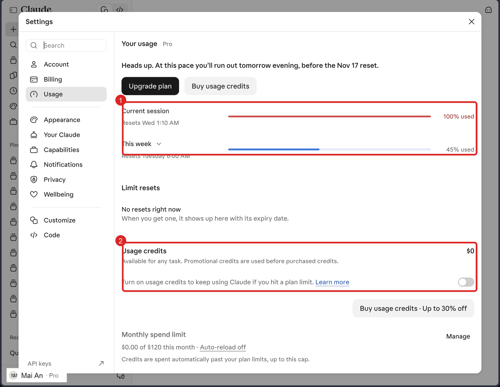
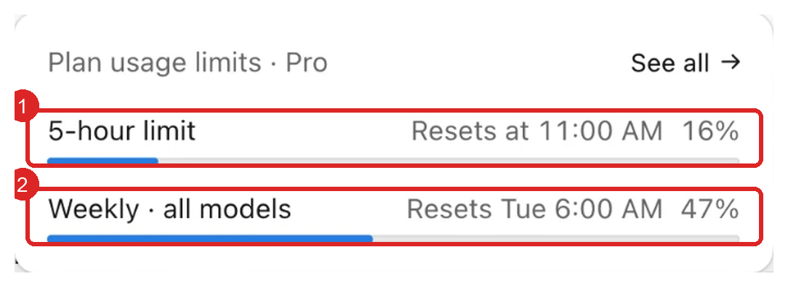
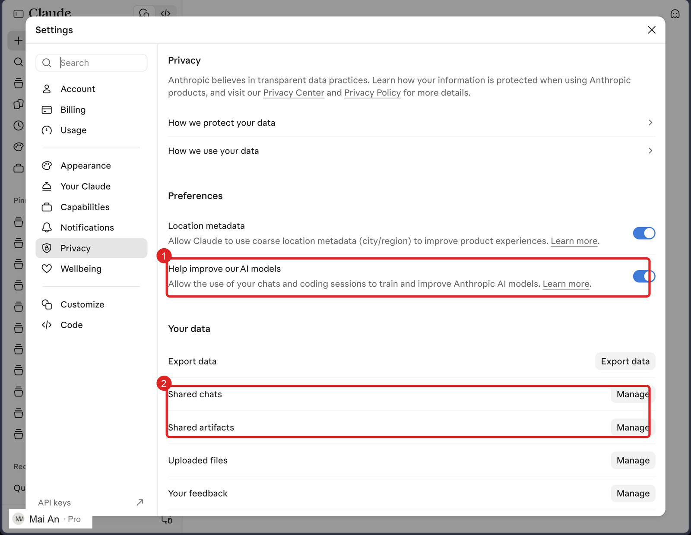
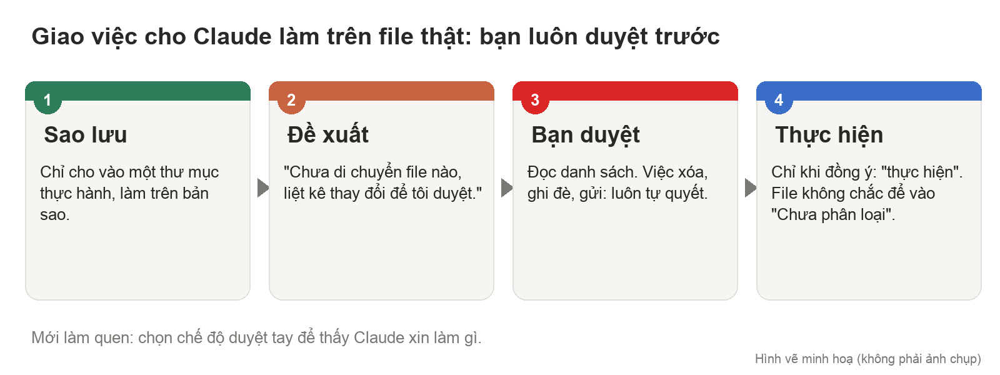
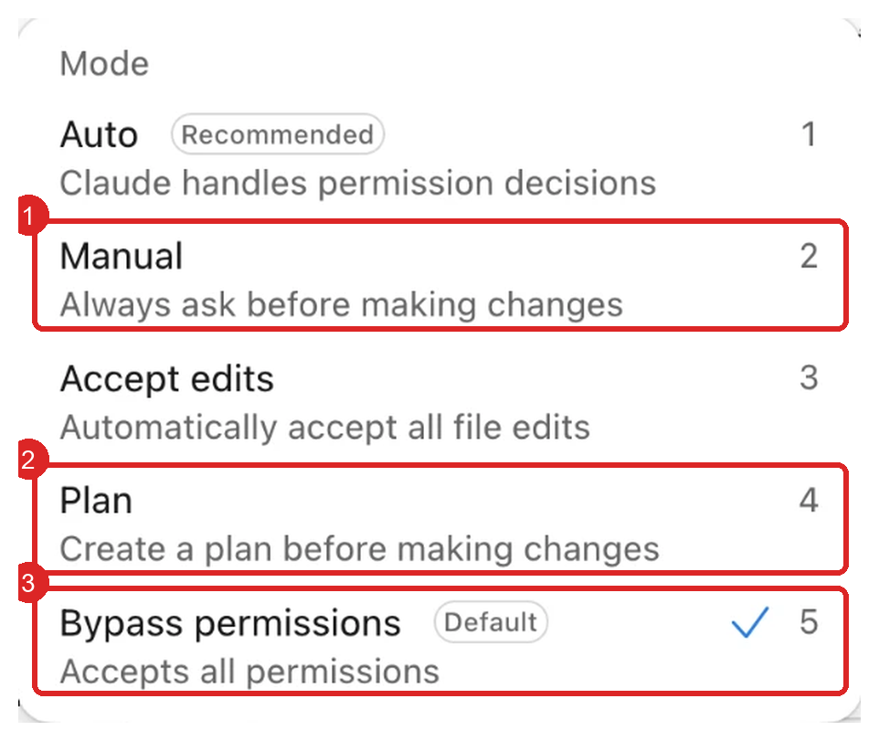
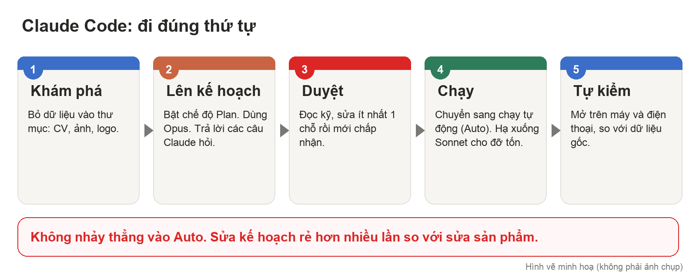

BÀI HỌC TRÀ ĐÁ
Bài 3/3: Kiểm soát Claude và làm sản phẩm đầu tay bằng Claude Code
Thời lượng gợi ý: 2 giờ, chia 2 buổi (Phần 5 trước, Phần 6 sau).

Dán vào: cuộc chat có trợ lý Trà Đá. Câu lệnh trong từng bước thì làm ở Claude, rồi quay về dán kết quả.

---------------------------------------------------------------------

BẠN SẼ LÀM ĐƯỢC GÌ SAU BÀI NÀY
- Biết mình đã dùng bao nhiêu giới hạn và biết cách không để hết giữa chừng.
- Biết chọn những gì Claude được phép nhớ, được phép dùng và được phép làm trên máy bạn.
- Làm được một sản phẩm nhỏ (trang giới thiệu cá nhân) bằng Claude Code theo đúng thứ tự: khám phá, lên kế hoạch, duyệt, làm, tự kiểm. Không cần biết lập trình.

VÌ SAO BÀI NÀY QUAN TRỌNG
Claude càng làm được nhiều thì càng cần người cầm lái. Khi Claude tự mở file, tự chạy nhiều bước, tự chia sẻ link, một quyết định bấm vội có thể làm mất file hoặc lộ thông tin. Bài này dạy cách dùng mạnh mà vẫn an toàn: bạn quyết, Claude làm.

CẦN CHUẨN BỊ
- Đã xong Bài 1 và Bài 2.
- Thư mục "Claude-Thuc-Hanh" trong Tài liệu, chứa 15–20 file lộn xộn là BẢN SAO (không dùng file gốc quan trọng).
- Dữ liệu cho trang giới thiệu: CV, ảnh, logo.
- Sổ tay Trà Đá, tiêu đề "Bài Claude 3 - <tên phần>".

BẢN ĐỒ BÀI
Phần 5: Kiểm soát (giới hạn, độ dài chat, chất lượng, riêng tư, quyền) → Phần 6: Claude Code.

---------------------------------------------------------------------

PHẦN 5. KIỂM SOÁT

Bước 5.1 Kiểm soát giới hạn dùng (Settings → Usage)
Hiểu trước: giống thẻ điện thoại trả trước có hai hạn mức. Một hạn mức theo phiên khoảng 5 giờ, một hạn mức theo tuần. Hết phiên thì chờ reset; hết tuần thì chờ sang tuần mới. Ví dụ: 2 giờ đầu đã dùng gần hết phiên thì 3 giờ sau ngồi chơi.
Làm:
1. Vào Settings → Usage, xem % phiên và % tuần đã dùng, giờ reset.
2. Thói quen: mỗi lần làm việc dài, mở Usage xem trước. Mới đầu phiên mà tiêu nhiều thì xuống mô hình thấp, chat ngắn lại. Đừng dùng dồn vài ngày là hết cả tuần.
3. Extra usage (nạp tiền dùng thêm): chỉ bật khi việc quan trọng sắp xong mà hết giới hạn. Đặt hạn mức thấp vì mô hình cao tiêu tiền rất nhanh.
Hình minh hoạ (dùng tên giả, giao diện sáng):

Nhìn hình: ① phần giới hạn: Current session (phiên khoảng 5 giờ) và This week (cả tuần), mỗi thanh có % đã dùng và giờ reset. ② Usage credits: nạp tiền dùng thêm, mặc định tắt; chỉ bật khi thật cần.

Ảnh chụp thật từ app Claude (dùng tên giả):

Nhìn hình: trong app máy tính, khung Plan usage limits hiện sẵn gần ô nhắn (thường mở bằng vòng tròn nhỏ ở góc dưới bên phải). ① 5-hour limit: % đã dùng của phiên 5 giờ và giờ reset. ② Weekly · all models: giới hạn cả tuần. Bấm See all để mở trang Usage đầy đủ.

Đúng khi: bạn ghi vào Sổ tay % tuần đã dùng và giờ reset tiếp theo.

Bước 5.2 Kiểm soát độ dài cuộc chat
Hiểu trước: mỗi lần bạn nhắn một câu, Claude đọc lại cả cuộc chat từ đầu. Chat càng dài thì càng tốn giới hạn, và Claude càng dễ nhầm hoặc quên. Giống như cuộc họp kéo dài: ai cũng mệt và nhớ lẫn lộn.
Quy tắc: mỗi cuộc chat một vấn đề. Khoảng 10 tin nhắn mà thấy Claude bắt đầu lạc thì sang chat mới.
Làm: để mang thông tin sang chat mới, trong chat cũ dán:
```
Tóm tắt cuộc hội thoại này bằng các gạch đầu dòng: mục tiêu, các quyết định đã chốt, việc còn dở. Tôi sẽ dán sang chat mới.
```
Mở chat mới, dán bản tóm tắt, nhắn tiếp.
Đúng khi: chat mới hiểu tiếp mạch mà ngắn hơn chat cũ nhiều.

Bước 5.3 Kiểm soát chất lượng câu trả lời
Hiểu trước: câu hỏi mơ hồ thì câu trả lời chung chung. Cách tốt nhất không phải viết câu dài hơn mà là bắt Claude hỏi ngược lại bạn.
Làm: thêm vào cuối yêu cầu của bạn:
```
Trước khi làm, hãy hỏi tôi kỹ về mục tiêu và bối cảnh. Tôi trả lời xong bạn mới bắt đầu.
```
Mẹo: nói bằng giọng (nhập giọng nói trên máy, hoặc công cụ chuyển giọng nói thành chữ) giúp bạn truyền nhiều ý nhanh hơn gõ. Nói rối cũng được, rồi bắt Claude hỏi lại cho rõ.
Số liệu và nguồn: luôn bắt Claude ghi nguồn, rồi bạn mở xem.
Đúng khi: bạn thử một yêu cầu thật, Claude hỏi ngược 3–5 câu, và câu trả lời cuối sát hơn lần không hỏi.

Bước 5.4 Kiểm soát dữ liệu và riêng tư (Settings → Privacy)
Hiểu trước: bạn quyết dữ liệu của mình được dùng ra sao. Thông tin khách hàng, tài chính, hợp đồng là loại cần cân nhắc nhất.
Làm:
1. Mục cho phép dùng chat của bạn để cải thiện mô hình: đọc mô tả hiện tại và quyết định. Nếu thường xử lý thông tin nhạy cảm, nên tắt.
2. Mục quản lý chia sẻ: xem lại những chat và artifact bạn đã chia sẻ. Cái nào không cần nữa thì Unpublish hoặc xóa link. Làm định kỳ.
3. Memory: bật để Claude nhớ bạn tốt hơn; ngại thì tắt, hoặc xóa từng mục nhớ. Việc rất nhạy cảm thì đừng đưa vào.
4. Mục công cụ (Capabilities, Tool access): có thể bật hết cho tiện, và chọn kiểu nạp công cụ khi cần (load tools when needed) để đỡ tốn giới hạn.
Hình minh hoạ (dùng tên giả, giao diện sáng):

Nhìn hình: ① công tắc cho phép dùng chat của bạn để cải thiện mô hình: đọc mô tả bên dưới rồi tự quyết. ② các mục Shared chats, Shared artifacts: bấm Manage để xem và gỡ những thứ đã chia sẻ.

Đúng khi: bạn có ảnh trang Privacy sau khi chọn (che thông tin cá nhân), kèm 1 câu nói vì sao chọn thế, và đã rà danh sách chia sẻ.

Bước 5.5 Kiểm soát quyền khi Claude tự làm việc (Cowork, Code, Schedule)
Hiểu trước: khi Claude tự thao tác trên máy bạn, rủi ro lớn nhất là xóa hoặc ghi đè nhầm. Nguyên tắc: bắt Claude đề xuất trước, bạn duyệt rồi mới làm.
Quy tắc an toàn:
- Mới làm quen: chọn chế độ Manual để thấy Claude xin làm gì. Chế độ Bypass permissions (nhận mọi quyền) chỉ dành cho người đã quen và đã sao lưu.
- Chỉ cho Claude vào đúng một thư mục thực hành, không cho cả ổ đĩa.
- Việc có xóa, ghi đè, gửi email, chi tiền: luôn tự duyệt, kể cả khi đang ở Auto.
- Sao lưu thư mục trước khi giao việc.
Hình vẽ minh hoạ:

Nhìn hình: bốn bước ①②③④ luôn đi theo thứ tự này, kể cả khi bạn đang ở chế độ Auto.

Ảnh chụp thật từ app Claude (dùng tên giả):

Nhìn hình: ① Manual: luôn hỏi trước khi sửa. Nên dùng khi mới làm quen. ② Plan: lập kế hoạch trước khi làm, dùng ở Bước 6.2. ③ Bypass permissions: nhận mọi quyền, không hỏi nữa. Người mới đừng chọn chế độ này. Auto (Recommended): Claude tự quyết các quyền thông thường. Accept edits: tự nhận mọi chỉnh sửa file.

Làm (thử an toàn):
1. Cowork → chọn thư mục "Claude-Thuc-Hanh" (chứa bản sao), dùng Sonnet.
2. Dán:
```
Trong thư mục này, hãy đề xuất cách sắp xếp thành các thư mục gọn gàng. Chưa di chuyển file nào. Liệt kê danh sách thay đổi để tôi duyệt trước.
```
3. Đọc đề xuất. Đồng ý thì bảo "thực hiện". File nào Claude không chắc thì xếp vào thư mục "Chưa phân loại".
Đúng khi: các file được xếp đúng, không mất file nào, và bạn đã duyệt trước khi Claude chạy.

Dừng lại, tự hỏi:
- Việc nào của bạn bạn sẽ không bao giờ cho Claude tự làm mà không duyệt?
- Bạn đang chia sẻ link nào mà không còn cần?

---------------------------------------------------------------------

PHẦN 6. CLAUDE CODE: LÀM RA MỘT SẢN PHẨM NHỎ

Hiểu trước: Claude Code giống làm việc với một nhân viên IT. Bạn nói mục tiêu, họ làm. Bạn không cần biết lập trình, nhưng phải đi đúng thứ tự: khám phá, lên kế hoạch, làm, chốt. Nhiều người nhảy thẳng vào "làm đi" nên ra sản phẩm lộn xộn, sửa tốn công. Sửa kế hoạch rẻ hơn nhiều lần so với sửa sản phẩm.

Hình vẽ minh hoạ:

Nhìn hình: năm bước ①–⑤ đi từ trái sang phải. Mô hình cao dùng ở bước 2 (lập kế hoạch), mô hình thấp hơn dùng ở bước 4 (chạy).

Bước 6.1 Chuẩn bị thư mục (khám phá)
Làm: mở mục Code trong app, tạo thư mục mới (ví dụ "Ho-so-ca-nhan"), bỏ vào đó mọi dữ liệu liên quan: CV, ảnh, logo, PDF hồ sơ. Dữ liệu đầu vào càng đủ, sản phẩm càng tốt.
Đúng khi: thư mục có đủ dữ liệu bạn muốn Claude dùng.

Bước 6.2 Bật chế độ Plan và giao việc
Làm:
1. Chọn chế độ Plan ở danh sách chế độ cạnh ô nhắn (xem hình ở Bước 5.5). Ở bước này nên dùng mô hình cao (Opus) vì lập kế hoạch là phần khó nhất.
2. Dán yêu cầu, sửa phần trong ngoặc cho đúng bạn:
```
Từ các file trong thư mục này, hãy tạo một landing page giới thiệu bản thân tôi chuyên nghiệp, ấn tượng, dùng như hồ sơ năng lực gửi đối tác. Chỗ nào chưa có ảnh thì để khung trống. Giọng điệu [khiêm tốn, chân thành]. Hãy hỏi tôi mọi thông tin còn thiếu trước khi lên kế hoạch.
```
3. Trả lời các câu Claude hỏi (kiểu trang, bảng màu, ngôn ngữ, có form liên hệ không).
Đúng khi: Claude hỏi lại bạn ít nhất vài câu rồi mới đưa kế hoạch.

Bước 6.3 Duyệt kế hoạch
Hiểu trước: kế hoạch là hợp đồng giữa bạn và Claude. Đồng ý rồi mới chạy.
Làm: đọc kỹ kế hoạch. Chỗ nào khó hiểu thì bảo "giải thích bước này đơn giản hơn". Chỗ chưa đúng thì yêu cầu sửa. Khi hài lòng mới bấm chấp nhận và chuyển sang chạy tự động; lúc này có thể hạ xuống Sonnet cho đỡ tốn.
Đúng khi: bạn đã sửa ít nhất 1 chỗ trong kế hoạch trước khi duyệt (không chấp nhận ngay lần đầu).

Bước 6.4 Làm và tự kiểm
Làm: Claude tự làm (có thể 10–20 phút hoặc hơn); khi hỏi thì bạn trả lời. Xong thì bạn là người kiểm:
1. Mở trang trên máy tính và cả điện thoại.
2. Đọc lại từng chữ, bấm thử từng nút.
3. So với dữ liệu gốc: tên, số liệu, chứng chỉ, ngày tháng phải đúng.
4. Muốn sửa thì nói bằng lời, ví dụ: "Rút ngắn phần giới thiệu, thêm khối chứng chỉ."
Đúng khi: bạn ghi được 3 chỗ đã sửa hoặc đã kiểm lại.

Bước 6.5 Chốt, và đưa lên mạng nếu muốn
Hiểu trước: đưa lên mạng là xuất bản công khai, ai cũng thấy.
Làm:
1. Chỉ làm khi đã kiểm xong và chấp nhận mọi thông tin hiển thị công khai (số điện thoại, email, ảnh).
2. Hỏi Claude cách đưa lên web miễn phí (ví dụ Vercel) rồi làm theo từng bước.
3. Giữ lại bản chốt để quay về được khi sửa hỏng.
Mẹo: xem thanh cửa sổ ngữ cảnh (context) để biết còn bao nhiêu chỗ; việc mới hẳn thì mở phiên mới. Bí ở đâu hỏi Claude đúng chỗ đó.
Đúng khi: có trang chạy được trên máy hoặc một đường link, và bạn đã tự kiểm theo Bước 6.4.

Dừng lại, tự hỏi:
- Vì sao phải duyệt kế hoạch trước khi cho chạy tự động?
- Thông tin nào trên trang bạn sẽ không để công khai?

---------------------------------------------------------------------

TỔNG KẾT: 3 ĐIỀU NHỚ
1. Xem Usage thường xuyên, mỗi chat một vấn đề, bắt Claude hỏi lại trước khi làm.
2. Quyền cho Claude ở mức tối thiểu; việc xóa, ghi đè, gửi, xuất bản luôn do bạn duyệt.
3. Với Claude Code: khám phá, kế hoạch, duyệt, làm, tự kiểm. Không nhảy thẳng vào chế độ tự động.

ĐẠT KHI
1. Ghi được % giới hạn tuần đã dùng và giờ reset tiếp theo.
2. Đã tóm tắt một chat dài sang chat mới và chat mới hiểu tiếp mạch.
3. Ảnh trang Privacy sau khi chọn (che thông tin cá nhân), kèm 1 câu giải thích; đã rà danh sách chia sẻ.
4. Bài thử Cowork: Claude đề xuất trước, bạn duyệt, không mất file nào.
5. Có sản phẩm Claude Code làm đúng thứ tự, kèm 3 chỗ bạn đã sửa hoặc kiểm.

TIÊU CHÍ CHẤM
- Bằng chứng thật cho từng mục; không lộ thông tin riêng.
- Chỉ đưa lên mạng khi đã kiểm và chấp nhận mọi thông tin hiển thị công khai.
- Việc có xóa, ghi đè, gửi, chi tiền luôn do bạn duyệt.

LỖI HAY GẶP
- Hết giới hạn: chat quá dài hoặc mô hình quá cao. Mở chat mới, xuống Sonnet.
- Claude bịa số liệu: bắt ghi nguồn, tự kiểm.
- Cowork làm hỏng thư mục: chưa sao lưu hoặc cho Auto quá sớm.
- Landing page lộn xộn: bỏ qua bước Plan hoặc dữ liệu đầu vào quá ít.

LƯU KẾT QUẢ
Sổ tay Trà Đá, tiêu đề "Bài Claude 3": ảnh Usage và Privacy, kế hoạch Claude lập, link hoặc ảnh sản phẩm, 3 chỗ đã sửa.

DÙNG TIẾP
Mỗi tháng quay lại 15 phút: xem Usage, danh sách chia sẻ, quyền connector.
